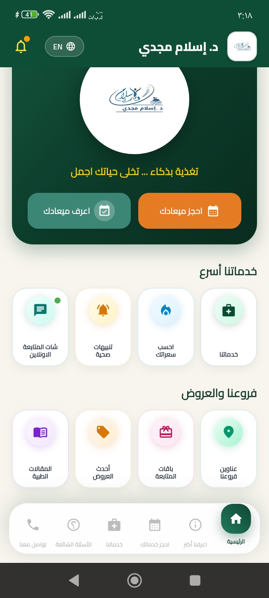

# Weight Loss Clinics App


تطبيق Flutter لإدارة عيادات إنقاص الوزن - نظام شامل لإدارة المواعيد، تتبع الوزن، وخطط التغذية المخصصة.

## 📸 لقطات الشاشة

<div align="center">
  
</div>

## 🌟 المميزات الرئيسية

### 📅 حجز المواعيد
- نظام حجز سهل وسريع للمواعيد مع العيادات
- عرض المواعيد القادمة والسابقة
- إشعارات تذكير بالمواعيد
- إمكانية إلغاء أو إعادة جدولة المواعيد

### ⚖️ تتبع الوزن
- تسجيل وتتبع وزن المريض بشكل دوري
- رسوم بيانية توضح التقدم في إنقاص الوزن
- حسابات تلقائية لنسبة الخسارة في الوزن
- تذكيرات بتسجيل الوزن

### 🥗 خطط غذائية مخصصة
- خطط غذائية مصممة خصيصاً لكل مريض
- قائمة بأطباق ووجبات مقترحة
- معلومات عن السعرات الحرارية والقيم الغذائية
- تتبع الالتزام بالخطة الغذائية

### 👨‍⚕️ إدارة العيادات
- عرض قائمة العيادات المتاحة
- معلومات مفصلة عن كل عيادة
- تقييمات العيادات من المرضى
- موقع العيادات على الخريطة

## 🚀 التقنيات المستخدمة

- **Framework**: Flutter 3.47.8
- **Language**: Dart
- **Platforms**: iOS & Android
- **State Management**: (أضف نظام إدارة الحالة المستخدم)
- **Database**: (أضف قاعدة البيانات المستخدمة)
- **API**: (أضف التفاصيل إذا كان هناك API)

## 📋 المتطلبات

- Flutter SDK 3.47.8 أو أحدث
- Dart SDK 3.5 أو أحدث
- Android Studio / Xcode
- جهاز Android أو iOS أو محاكي

## 🔧 التثبيت

1. استنساخ المستودع:
```bash
git clone https://github.com/yousse8f/Weight-Loss-Clinics-App.git
cd Weight-Loss-Clinics-App
```

2. تثبيت الحزم المطلوبة:
```bash
flutter pub get
```

3. تشغيل التطبيق:
```bash
flutter run
```

## 📱 البناء

### بناء Android APK:
```bash
flutter build apk --release
```

### بناء iOS:
```bash
flutter build ios --release
```

## 🛠️ هيكل المشروع

```
lib/
├── main.dart                 # نقطة الدخول الرئيسية
├── models/                   # نماذج البيانات
├── screens/                  # شاشات التطبيق
├── widgets/                  # المكونات القابلة لإعادة الاستخدام
├── services/                 # الخدمات و API
├── utils/                    # أدوات مساعدة
└── config/                   # ملفات التكوين
```

## 🤝 المساهمة

المساهمات مرحب بها! يرجى اتباع الخطوات التالية:

1. Fork المستودع
2. أنشئ فرع للميزة الجديدة (`git checkout -b feature/AmazingFeature`)
3. Commit التغييرات (`git commit -m 'Add some AmazingFeature'`)
4. Push إلى الفرع (`git push origin feature/AmazingFeature`)
5. افتح Pull Request

## 📝 الترخيص

هذا المشروع مرخص تحت رخصة MIT - انظر ملف [LICENSE](LICENSE) للتفاصيل.

## 👤 المطور

Youssef - [@yousse8f](https://github.com/yousse8f)

## 📞 التواصل

إذا كان لديك أي أسئلة أو اقتراحات، يرجى فتح Issue في المستودع أو التواصل عبر:
- البريد الإلكتروني: you7sse5f@gamil.com 

## 🙏 شكر وتقدير

- Flutter Team لإنشاء إطار عمل رائع
- جميع المساهمين في المشروع

---

⭐ إذا أعجبك المشروع، لا تنسَ إعطائه نجمة على GitHub!
